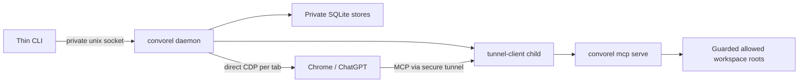

# Architecture

Convorel 1.0 is one Go binary with a thin JSON CLI, a resident daemon and an MCP stdio entry point. A local coding agent owns edits, tests and decisions. ChatGPT reviews through the user's logged-in Chrome and can inspect explicitly shared code through the guarded MCP functions. Runtime guidance supplies workspace/tool instructions as a normal user message; review strategy, triggers and decision gates belong to the independently installable chatgpt-review skill.

## Ownership and dependencies

`cmd/convorel` starts `internal/cli`. `internal/rpc` frames bounded socket requests. `internal/daemon` owns command dispatch, single-instance election and registration of the conversation engine. `internal/config` preserves file locations/preferences. `internal/store` owns operational task documents and diagnostics; `internal/archive` owns the content projection and FTS5 trigram search. `internal/conversation` coordinates durable runs using `internal/chatgpt` page actions and `internal/cdp` transport/browser lifecycle. `internal/service` manages systemd, tunnel supervision, installation, upgrades and skills. `internal/mcp` uses the official Go SDK and `internal/workspace` policy/evidence/Git APIs.

The daemon is the single operational writer. Per-task mutexes serialize browser side effects; short registry/store transactions enforce global request and binding uniqueness. Independent tabs can progress concurrently. Single-instance election holds a nonblocking advisory flock on the state directory inode, without a separate lock file. Kernel release on death lets a successor remove a stale socket. Preferences use an in-process mutex. Stop all old processes before cutover.

The socket `<state-dir>/convorel.sock` is 0600 inside a 0700 directory. RPC is bounded newline-delimited JSON (8 MiB). Deadlines bound caller subscriptions; run execution uses the daemon lifecycle context. CLI stdout is one final JSON document with an outcome exit status. MCP stdio alone reserves stdout for protocol frames. No connected request is automatically replayed.

## Durable data and send safety

Defaults remain `~/.config/convorel/preferences.json` and `~/.local/share/convorel/{config.json,tasks.db,diagnostics.db,conversations.db}`. Global `--config-dir` and `--state-dir` select alternate paths. Existing version-one SQLite schemas and data are read in place with pure Go modernc SQLite, including existing FTS5 trigram indexes. Operational documents remain truth; archive publication cannot change send authorization or completion. WAL and FULL synchronous durability preserve operational/archive commits. Immutable content versions, selected prompt/reply versions, rendered fallback text and capture gaps remain distinct.

Each task binds a canonical workspace and saved conversation configuration. Each run stores original input, versioned guidance, rendered prompt, correlation marker and hashes before a send. Request IDs are claimed atomically. Replays return the original run; conflicting content fails. Continuation verifies the preceding turn and saved conversation rather than silently creating a replacement. Workspace binding is not access authorization.

Phases are `prepared`, `rejected`, `delivered`, `delivery_unknown`, `complete`, `failed`, `blocked`, `superseded`, and legacy `lost`. Network request dispatch, POST status, input-message identity and stream completion provide delivery facts. HTTP 200 alone is insufficient. Only a prepared run without dispatched POST or a confirmed rejected send permits explicit retry, using its frozen prompt. Unknown delivery is observe-only forever unless later evidence resolves it. Restart recovery never invents permission to resend.

The CDP client subscribes before sending and captures streaming bytes while available; an aborted transport after a complete stream is not itself a failed reply. Page scripts require a unique visible editable composer, check model/effort and project/conversation/message identity, then perform native CDP input. Multiple/hidden controls, missing or disabled controls and mismatched identities fail closed. DOM fallback requires a current unambiguous turn and completion evidence. Markdown comes from the exact assistant reply's Copy control, with rendered text retained separately for traceability.

## Completion and resources

`ask` prepares and sends; `followup` continues the bound conversation. `wait` immediately returns the completed saved reply, independently of background naming and archive notices. A killed wait subscriber does not kill observation. Naming uses `MMDD｜TYPE｜Topic`, deriving the date from conversation creation in Asia/Shanghai, and verifies the target conversation. It changes neither project membership nor run outcome. Status reports naming separately.

The daemon's Chrome manager holds one direct CDP session per tab and owns only the Chrome it launches. Idle reservations span browser startup, send, reply observation and naming. After 10 minutes without active reservations (configurable), managed Chrome stops; the next operation starts it again. External Chrome is never terminated. Finish verifies the completed reply, identity and empty draft, then closes only the owned tab. It preserves history and remote conversations.

`convorel.service` supervises the daemon with restart-on-failure and control-group cleanup. The daemon supervises the outbound tunnel client; the latter spawns the same executable as `mcp serve`. Service restart may terminate managed Chrome; recovered runs reattach/reopen their saved conversation under identity checks. For a first send whose identity was interrupted, recovery inspects at most five recent page-owned conversation-list/sidebar candidates and adopts only a conversation created since dispatch with exactly one user turn containing the saved marker and no conflicting known identity. Recovery never sends. Metadata and rename verification observe the application’s authenticated network responses; they never manufacture backend fetches.

## Workspace boundary

MCP exposes exactly `capabilities`, `exec`, `artifact`, `memory`. One shared policy denies outside-root, traversal, symlink/hardlink/special-file, credential, VCS/dependency and private-state access; applies ancestor ignore files; detects replaced roots; and bounds file, tree, search, patch and history reads. Malformed policies fail closed. Git runs with hardened flags/environment and object-store/worktree validation; project identity uses the nearest repository root.

Exec parses one supported command without shell expansion. Internal evidence operations and read-only Git aliases share the policy. The retained Bun build/test executor requires Linux Bubblewrap/prlimit, an isolated filtered snapshot, explicit dependency grants, and bounded time/output/process groups. It cannot modify the source workspace. Memory requires explicitly shared OpenViking URI subtrees and a separately installed ov CLI. Browser access and MCP sharing are independent channels.

[cli.md](cli.md) specifies command fields and extension APIs; [security.md](security.md) details trust boundaries; [validation.md](validation.md) maps fixture checks to acceptance limits. The dated robustness audit is historical and does not describe the current implementation.
